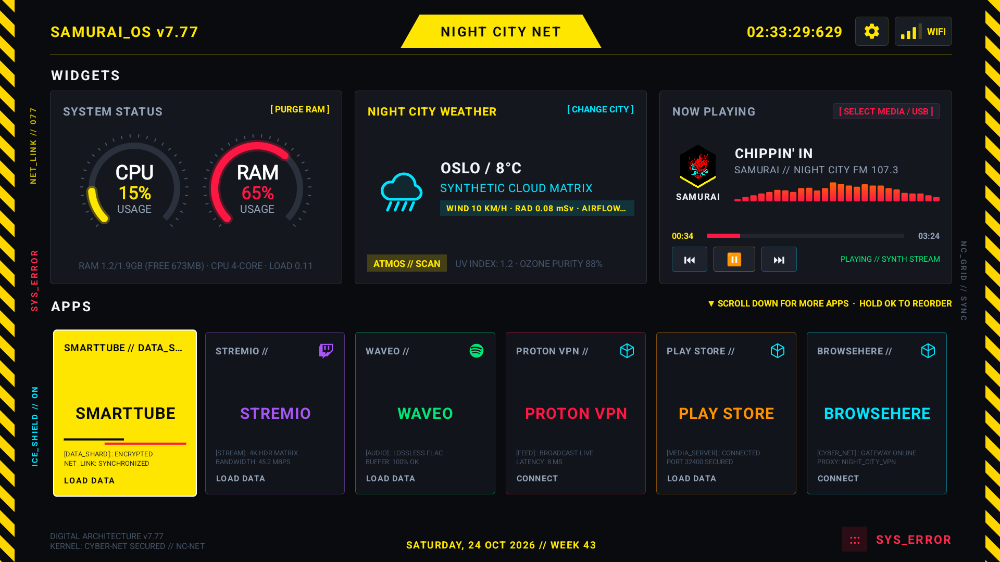
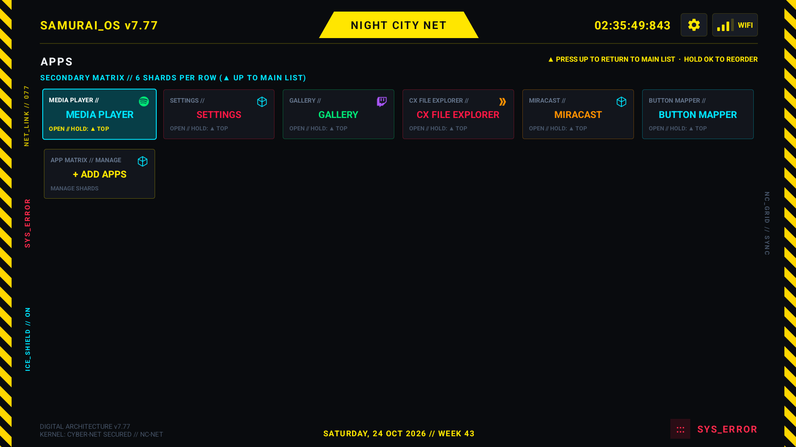

# Cyberpunk TV Launcher (SamuraiOS)

|          Cyberpunk 2077 HUD Homescreen           |
| :----------------------------------------------: |
|  |

|          Cyberpunk 2077 HUD Secondary Matrix         |
| :----------------------------------------------: | 
|  |

Builds on [cleanyourtv](https://github.com/Gathin23/cleanyourtv) by Gathin (debloat-and-launcher workflow) with a Cyberpunk 2077 HUD design for Android TV.

Most TV home screens are ad-bloated storefronts. **SamuraiOS** turns your TV into a Cyberpunk netrunning terminal: live kernel memory/CPU telemetry, weather, a music deck with a frequency visualizer, and an app matrix organized into data shards. Paste [`PROMPT.md`](PROMPT.md) into an AI coding assistant, or run the included shell scripts, to debloat, configure, and install it.

**Compatibility:** Android TV / Google TV, Android 9+. Not compatible with Samsung (Tizen), LG (webOS), or Fire TV.

---

## Features

- **Cyberpunk HUD design** — dark carbon background, Cyberpunk yellow/cyan/purple/green/red accents, hazard-stripe margins, live millisecond clock, Wi-Fi monitor, date/week indicator.
- **Hardware telemetry** — live CPU and RAM gauges from `/proc/meminfo`, plus a one-click **`[ PURGE RAM ]`** button (via a background helper daemon) to clear caches and free memory.
- **Weather** — powered by Open-Meteo (no API key needed), shown as Cyberpunk-themed environmental warnings; click to search/select a city.
- **Audio deck** — Cyberpunk Oni-themed player with an animated spectrum visualizer, full playback controls, and local/USB audio file scanning (MP3/FLAC/WAV/OGG).
- **App matrix** — 6-shard primary dock plus an expandable secondary grid of all installed apps; long-press to reorder/move shards; 9 selectable accent colors.

---

## Quick Start

### Requirements
- Android TV / Google TV device, Android 9+
- USB data cable or same-Wi-Fi connection
- JDK 17 and Android SDK (platform 34, build-tools 34)

### 1. Enable developer options on the TV
*Settings > System > About* → press **Build** 7 times → *Settings > System > Developer options* → enable **USB debugging** (and **Network debugging**/"ADB debugging" if using Wi-Fi). Accept the "Allow USB debugging?" prompt with your remote.

### 2. Connect
Connect via USB cable, Wi-Fi, or a PC-to-TV Ethernet cable (the TV just needs an IP on the same network as your computer).

### 3. Run the prompt
Once connected, open your AI coding CLI (e.g. [Antigravity](https://antigravity.google/) CLI) in this repo and paste in [`PROMPT.md`](PROMPT.md). It handles the debloat, configuration, and install steps for you.
