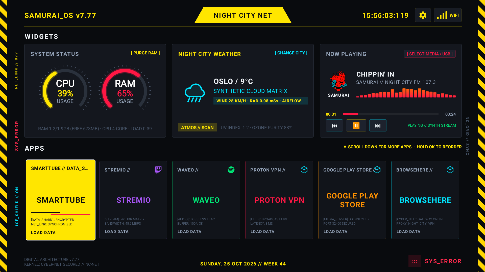
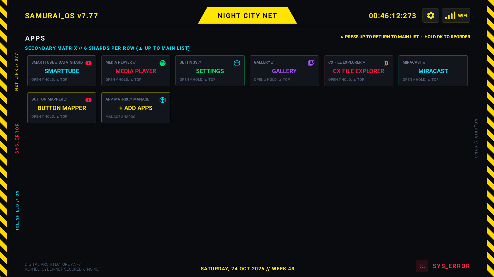
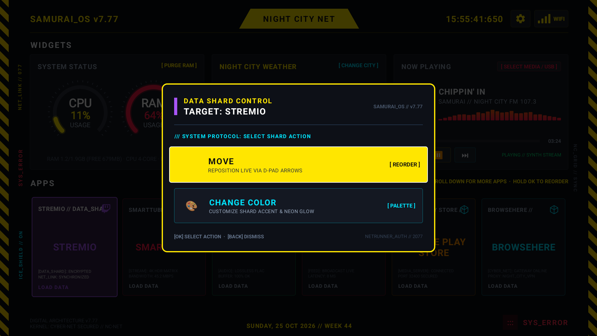
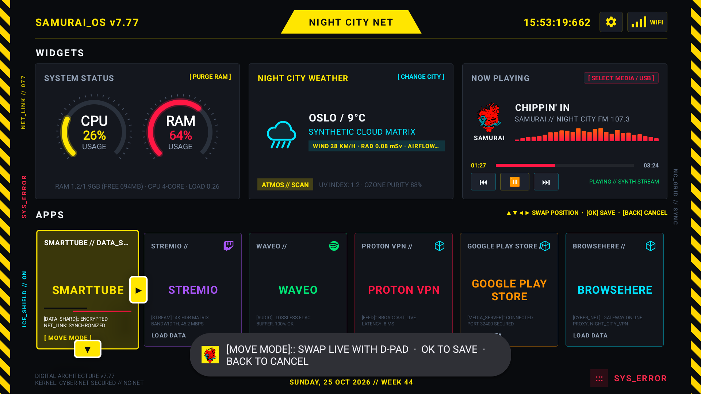
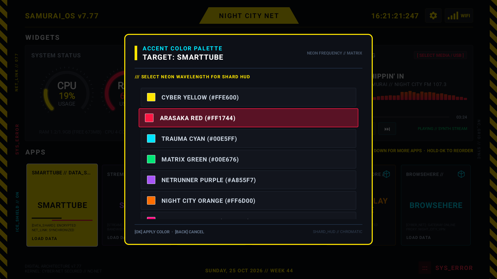
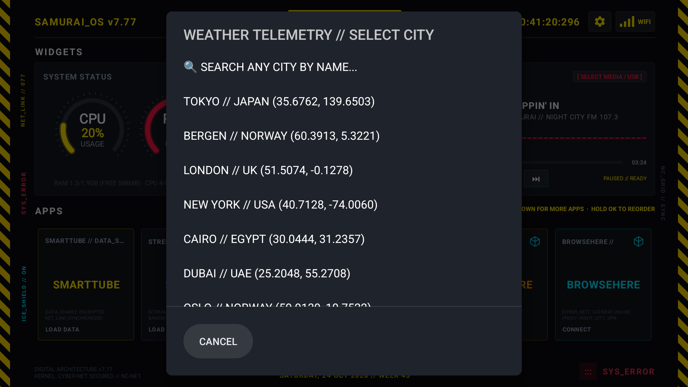
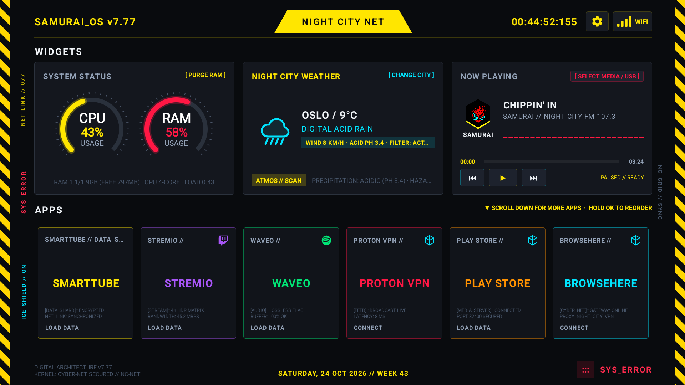
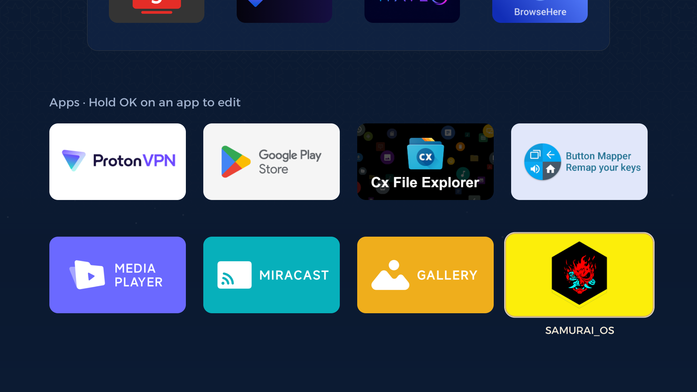

# Cyberpunk TV Launcher (SamuraiOS)

**A high-tech, Cyberpunk 2077 inspired HUD home screen and performance suite for Android TV & Google TV: dual CPU/RAM circular gauges, privileged memory optimization daemon, live weather with environmental hazard telemetry, Samurai audio visualizer with USB playback, and custom data-shard app matrix.**

```text
+========================================================================================+
|  SAMURAI_OS v7.77            [ NIGHT CITY NET ]             21:18:18:181  [⚙]  [📶 WIFI]|
|========================================================================================|
| / /                                                                                \ \ |
| / /   WIDGETS                                                                      \ \ |
| / /                                                                                \ \ |
| / /   [ SYSTEM STATUS ]         [ NIGHT CITY WEATHER ]      [ NOW PLAYING ]        \ \ |
| / /   (CPU 28%)  (RAM 59%)      (icon) OSLO / 9°C           [ONI] CHIPPIN' IN      \ \ |
| / /   RAM 1.1/1.9GB (FREE 759MB)SYNTHETIC CLOUD MATRIX      SAMURAI // NIGHT CITY  \ \ |
| / /   CPU 4-CORE · LOAD 0.28    WIND 7 KM/H · RAD 0.08 mSv  ====================   \ \ |
| / /                             ATMOS // SCAN UV 1.2        [⏮] [▶] [⏭]  PAUSED    \ \ |
| / /                                                                                \ \ |
| / /   APPS                                                                         \ \ |
| / /   +-----------+ +-----------+ +-----------+ +-----------+ +-------+ +-------+  \ \ |
| / /   |  YOUTUBE  | |  NETFLIX  | |PRIME VIDEO| |   PLEX    | |BROWSER| |SETTING|  \ \ |
| / /   | DATA_SHARD| |           | |           | |           | |       | |       |  \ \ |
| / /   | LOAD DATA | | LOAD DATA | | LOAD DATA | | LOAD DATA | |CONNECT| |CONNECT|  \ \ |
| / /   +-----------+ +-----------+ +-----------+ +-----------+ +-------+ +-------+  \ \ |
| / /                                                                                \ \ |
| / /   KERNEL: CYBER-NET SECURED      FRIDAY, 23 OCT // WEEK 43          SYS_ERROR  \ \ |
+========================================================================================+
```



Most TV home screens are ad-bloated storefronts. **SamuraiOS** turns your TV into a responsive Cyberpunk netrunning terminal: real-time kernel memory and CPU load tracking, environmental telemetry, a full music deck with dynamic frequency bars, and an app matrix organized into high-contrast data shards. You don't configure it manually: paste [`PROMPT.md`](PROMPT.md) into an AI assistant (Claude Code, Antigravity, etc.) or run the included shell scripts to safely debloat the TV, configure the launcher, and install it.

Everything is non-destructive, requires **no root**, and is **100% reversible**.

---

## Features

### 1. Cyberpunk 2077 HUD Design
- High-contrast matte dark carbon background with official Cyberpunk yellow (`#FCEE0A`), neon cyan, electric purple, matrix green, and neon red accents.
- Full-height safety hazard stripes along screen margins with `SYS_ERROR` markings.
- Real-time millisecond clock ticker (`HH:mm:ss:SSS`), Wi-Fi signal monitor, and bottom-middle date indicator with ISO week number (`FRIDAY, 23 OCT // WEEK 43`).
- 100% full-bleed solid yellow Leanback TV banner and launcher app icon matching standard Android TV home grids.

### 2. Real-Time Hardware Telemetry & Privileged Memory Purge
- **Live CPU Gauge**: Real-time CPU load percentage and multi-core calculation.
- **Live RAM Gauge**: Accurate kernel memory telemetry directly from `/proc/meminfo` (`RAM 1.1/1.9GB (FREE 816MB)`).
- **Privileged RAM Optimization**: One-click **`[ PURGE RAM ]`** communicates with a background helper daemon (`tools/samurai_helper.sh`, running as `UID 2000`) to terminate cached background tasks, sweep system caches, and free RAM instantly.

### 3. Environmental Weather Telemetry & City Selector
- Powered by Open-Meteo (free, no API key required).
- Translates live weather conditions into Cyberpunk environmental warnings (*SYNTHETIC CLOUD MATRIX*, *DIGITAL ACID RAIN*, *INDUSTRIAL TOXIC SMOG*, *RADIATION LEVEL*).
- Click the weather card to open an interactive city selector with live search or Cyberpunk city presets.

### 4. Interactive Samurai Audio Deck
- Featuring the iconic Cyberpunk Samurai Oni emblem.
- Dynamic multi-band audio spectrum visualizer with animated equalizer bars.
- Built-in visual demo track (`CHIPPIN' IN // NIGHT CITY FM 107.3`) with continuous seamless looping equalizer animation, plus full media playback controls (`⏮`, `▶/⏸`, `⏭`, seek bar).
- **USB & Local Audio Playback**: Scans internal storage and connected USB drives for audio files (`MP3`, `FLAC`, `WAV`, `OGG`) with system file picker support.

### 5. Data Shard App Matrix & Deep Customization
- **Primary Dock**: 6 pinned Data Shards that light up with custom scale, neon glow, and inverted black typography when focused.
- **Secondary App Matrix**: Scroll down to open an expanded 6-shards-per-row grid of all installed TV apps. The main row hides automatically when entering the secondary matrix.
- **Shard Controls & Interactive Live Move Mode**: Long-press OK (or press Menu) on any app shard to summon the Cyberpunk modal with **`MOVE`** and **`CHANGE COLOR`**:
  - **Live Move Mode**: Displays 4 animated pulsing directional arrows (`▲`, `▼`, `◀`, `▶`) around the selected app indicating valid movement directions (edge arrows hide automatically).
  - **Live Swapping**: D-pad directional presses immediately swap the app card in real time across the matrix and dock.
  - **Commit / Revert**: Pressing **`OK`** persists the new layout; pressing **`BACK`** instantly cancels and reverts all apps to their original positions.
- **Custom Shard Color Palette**: Pick from 20 curated Cyberpunk neon colors (*Cyber Yellow*, *Arasaka Red*, *Trauma Cyan*, *Matrix Green*, *Netrunner Purple*, *Night City Orange*, *Neon Magenta*, *Pure White*, *Kiroshi Gold*, *Militech Green*, *Badlands Amber*, *Electric Blue*, *Rogue Violet*, *Laser Lime*, *Deep Crimson*, *Ice Blue*, *Acid Yellow*, *Ghost White*, *Corpo Blue*, *Default Accent*). Features high-contrast badges, clipped scroll protection, and full margin scaling.

---

## Screenshots

| Cyberpunk 2077 HUD Homescreen | Expanded Secondary App Matrix |
| :---: | :---: |
|  |  |

| Shard Control Menu | Interactive Live Move Mode |
| :---: | :---: |
|  |  |

| Custom Shard Accent Colors | Environmental City Telemetry |
| :---: | :---: |
|  |  |

| Memory Optimization Purge | Full-Bleed Leanback Tile in Other Launchers |
| :---: | :---: |
|  |  |

---

## Quick Start & Installation

### Requirements
- **Android TV or Google TV** device (Sony, TCL, Xiaomi, Hisense, Philips, Chromecast with Google TV, Nvidia Shield, etc.) running **Android 9 or newer**.
- USB data cable or local Wi-Fi connection on the same network.
- JDK 17 and Android SDK (platform 34, build-tools 34).

### 1. Connect to the TV
Enable **Developer options** (go to *Settings > System > About*, press OK on **Build** 7 times), then enable **USB debugging** (and **Network debugging** if connecting over Wi-Fi).

```bash
tools/connect.sh usb                 # For USB cable
# OR
tools/connect.sh wifi 192.168.1.50   # For Wi-Fi (replace with TV's IP)
```

| Connection | On the TV | Needs | Works On |
|---|---|---|---|
| **USB cable** | USB debugging | Data cable | Most streaming boxes/sticks (USB-C), some TVs |
| **Wi-Fi** | USB + Network debugging | Same network, TV IP address | Every Android TV / Google TV |

### 2. Configure Your City and Apps
Edit `launcher/app/src/main/res/values/config.xml`:
```xml
<string name="weather_city_label">NIGHT CITY // TOKYO</string>
<string name="weather_lat">35.6762</string>
<string name="weather_lng">139.6503</string>
<string name="weather_units">celsius</string>
```

### 3. Build & Install
```bash
tools/build-install.sh
```
This script compiles the APK with Gradle, pushes it to the TV, installs it via `pm install -r`, launches the background privileged RAM optimization helper daemon, and sets `tv.samurai.home/.MainActivity` as the default HOME launcher.

---

## Reversibility

Everything changed by this project is **100% reversible** without root:
```bash
tools/restore.sh
```
Restores your original stock TV launcher, re-enables all disabled vendor bloatware, and resets system settings.
